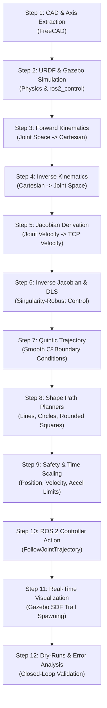

# 3-DOF Robotic Arm — Complete CAD-to-ROS 2 Motion Planning & Cartesian Trajectory Control

[](https://docs.ros.org/en/humble/)
[](https://classic.gazebosim.org/)
[](https://www.python.org/)
[](https://github.com/Workofficialmain/-robot-arm)

A complete end-to-end robotics project developing a **3-Degree-of-Freedom (3-DOF) articulated robotic arm**. The system covers the entire robotics lifecycle: from FreeCAD joint extraction and custom URDF physics modeling to analytical forward/inverse kinematics, Jacobian differential velocity mapping, damped least squares (DLS) singularity handling, quintic polynomial trajectory interpolation, dynamic safety validation, and ROS 2 `FollowJointTrajectory` execution and joint-state-based TCP tracking-error measurement in Gazebo.

---

## Table of Contents

1. [Project Workflow (Step-by-Step in Chronological Order)](#1-project-workflow-step-by-step-in-chronological-order)
2. [Robot Mechanical & Kinematic Specifications](#2-robot-mechanical--kinematic-specifications)
3. [Kinematics & Mathematics Deep-Dive](#3-kinematics--mathematics-deep-dive)
   - [3.1 Forward Kinematics (FK)](#31-forward-kinematics-fk)
   - [3.2 Inverse Kinematics (IK) & Dual Configurations](#32-inverse-kinematics-ik--dual-configurations)
   - [3.3 Jacobian Matrix (Differential Kinematics)](#33-jacobian-matrix-differential-kinematics)
   - [3.4 Inverse Jacobian & Damped Least Squares (DLS)](#34-inverse-jacobian--damped-least-squares-dls)
   - [3.5 How Everything Links Together (System Pipeline)](#35-how-everything-links-together-system-pipeline)
4. [Cartesian Shape Tracing: Square and Circle](#4-cartesian-shape-tracing-square-and-circle)
5. [Testing, Dry-Runs, and Verification](#5-testing-dry-runs-and-verification)
6. [Repository Architecture & File Map (Tabular Guide)](#6-repository-architecture--file-map-tabular-guide)
7. [How to Build and Run the Project](#7-how-to-build-and-run-the-project)

---

## 1. Project Workflow (Step-by-Step in Chronological Order)

The project was constructed following a structured 12-step engineering lifecycle. Each step builds directly upon the outputs of the previous step.



---

### Step 1: CAD Modeling & Joint Axis Extraction
* **What we did**: Analyzed 19 custom 3D STL parts in FreeCAD. Using Python inspection scripts (`shoulder_axes.py`, `elbow_wrist_axes.py`, `wrist_axes.py`), we extracted the exact geometric rotational pivot centers, link offsets, and joint axes of the arm.
* **Why we did it**: Real-world robots cannot be simulated accurately using guessed dimensions. Every joint rotation axis and link center of mass must align precisely with the physical mechanical CAD assemblies.
* **What it gives us / Output**:
  - Shoulder joint pivot: $(X=0.0, Y=0.0, Z=52.0)\text{ mm}$
  - Elbow joint pivot: $(X=30.0, Y=0.0, Z=288.8)\text{ mm}$
  - Tool Center Point (TCP / Tip): $(X=378.0, Y=0.0, Z=293.0)\text{ mm}$
  - Clean, correctly scaled millimeter STL mesh files for 3D visualization.

---

### Step 2: URDF Simulation & ros2_control Setup
* **What we did**: Authored automated URDF generation scripts (`make_urdf.py` and `make_gz_urdf.py`). These scripts assemble the STL meshes into a kinematic chain (`world` $\to$ `robot_base` $\to$ `link_turntable` $\to$ `link_upper_arm` $\to$ `link_forearm` $\to$ `end_effector`), configure mass and inertia tensors, set joint limits, lift the base by $80\text{ mm}$ so it rests on the Gazebo floor, and configure `gazebo_ros2_control` tags.
* **Why we did it**: Gazebo requires a dynamic description format with inertia tensors, collision bounding boxes, and transmission controllers to simulate physics (gravity, torque, friction) realistically.
* **What it gives us / Output**:
  - `robot_arm.urdf`: Visual URDF for RViz visualization.
  - `robot_arm_gz.urdf`: Full dynamic physics URDF for Gazebo simulation.
  - `controllers.yaml`: Hardware controller definitions for `joint_state_broadcaster` and `arm_controller` (`JointTrajectoryController`).

---

### Step 3: Analytical Forward Kinematics (FK)
* **What we did**: Derived closed-form trigonometric equations that take the 3 joint angles $q = [q_1, q_2, q_3]^T$ and output the exact $(x, y, z)$ position of the tool tip in 3D Cartesian space.
* **Why we did it**: The robot needs to know where its end-effector is in real-world coordinates based on live motor encoder readings.
* **What it gives us / Output**:
  - Function `forward_kinematics(q)` returning $(x, y, z)$ in millimeters with sub-nanometer numerical precision.

---

### Step 4: Analytical Inverse Kinematics (IK) & Dual Configurations
* **What we did**: Formulated geometric inverse kinematics using the Law of Cosines. Implemented reachability checking (workspace boundary validation) and solved for both **Elbow-Up** ($\delta < 0$) and **Elbow-Down** ($\delta > 0$) kinematic configurations.
* **Why we did it**: When planning tasks (such as tracing a square or line), the user commands where the tool tip should be in 3D space. The robot's motors, however, only rotate in joint space. IK translates desired 3D coordinates into required motor angles.
* **What it gives us / Output**:
  - Function `inverse_kinematics(x, y, z, elbow="up")` providing instant analytical joint configurations without iterative optimization drift.

---

### Step 5: Differential Kinematics & Analytical Jacobian
* **What we did**: Computed the exact partial derivatives of the forward kinematics functions with respect to each joint angle, creating the $3 \times 3$ Jacobian matrix $J(q)$.
* **Why we did it**: While position kinematics determines the final target, continuous motion control requires knowing how joint velocities $(\dot{q}_1, \dot{q}_2, \dot{q}_3)$ relate to linear tip velocities $(\dot{x}, \dot{y}, \dot{z})$. It is also the fundamental tool used to identify kinematic singularities.
* **What it gives us / Output**:
  - Matrix equation $V = J(q) \dot{q}$ evaluated at any robot pose.
  - Analytical singularity metric $\mu(q)$ identifying when the arm is near full stretch or self-folding.

---

### Step 6: Inverse Jacobian & Damped Least Squares (DLS)
* **What we did**: Implemented the Damped Least Squares (Levenberg-Marquardt pseudoinverse) inversion algorithm:
  $$J_{\text{damped}}^+ = (J^T J + \lambda^2 I)^{-1} J^T$$
  with adaptive damping $\lambda(q)$ calculated from the local singularity index.
* **Why we did it**: If the robot arm approaches a kinematic singularity, the standard inverse matrix $J^{-1}$ experiences a division by near-zero ($\det(J) \to 0$). Direct inversion commands near-infinite joint speeds, causing controller crashes and dangerous physical oscillations. DLS prevents speed blow-ups while maintaining path direction.
* **What it gives us / Output**:
  - Function `inverse_jacobian(q, damping)` that produces stable, safe joint velocities even when passing through or near singularities.

---

### Step 7: Quintic Polynomial Trajectory Generation
* **What we did**: Implemented 5th-order (quintic) polynomial interpolation for trajectories:
  $$s(u) = 10u^3 - 15u^4 + 6u^5, \quad u = \frac{t}{T} \in [0, 1]$$
* **Why we did it**: Linear interpolation creates infinite jerk and abrupt velocity steps at start and stop. Cubic polynomials have discontinuous accelerations. Quintic polynomials enforce zero velocity and zero acceleration at both the start and end ($C^2$ continuity), preventing mechanical wear, motor stalling, and structural vibration.
* **What it gives us / Output**:
  - Trajectory module `trajectories.py` outputting smooth joint profiles with zero velocity/acceleration boundary conditions.

---

### Step 8: Cartesian Shape Path Planning (Line, Circle, Rounded Square)
* **What we did**: Created path generators that discretize 2D/3D shapes into dense trajectory waypoints (50 Hz) and combine Cartesian path geometry, quintic time-scaling, IK, and DLS velocity mapping:
  1. **Straight Line**: Smooth linear interpolation between two 3D points.
  2. **Circle**: Parametric circular path with constant curvature.
  3. **Rounded Square**: Four straight segments joined by four circular blend arcs ($r_{\text{blend}} = 4.0\text{ mm}$) to avoid infinite corner acceleration.
* **Why we did it**: Real applications (dispensing, inspection, welding) require following geometric shapes in physical space.
* **What it gives us / Output**:
  - Modules `cartesian_planner.py` and `shape_planner.py` generating complete time-parameterized waypoint streams.

---

### Step 9: Safety Validation & Dynamic Time Scaling
* **What we did**: Built a dedicated safety validation engine (`safety.py`) checking every waypoint against:
  - Position limits (URDF joint bounds)
  - Velocity limits ($\le 2.0\text{ rad/s}$)
  - Acceleration limits ($\le 4.0\text{ rad/s}^2$)
  If any sample exceeds limits, an automated time-scaling algorithm computes a slowdown factor $s \le 1.0$ and stretches the execution duration without altering the geometric path.
* **Why we did it**: Helps keep planned joint positions, velocities, and configured acceleration limits within software limits. The configured acceleration ceiling is a planning limit, not a verified actuator torque or hardware rating.
* **What it gives us / Output**:
  - Fail-safe trajectory verification and automated retiming before execution.

---

### Step 10: ROS 2 Controller Action Integration
* **What we did**: Implemented `ros_trajectory.py` and `trajectory_publisher.py` interfacing with the ROS 2 `control_msgs/action/FollowJointTrajectory` action server on `/arm_controller/follow_joint_trajectory`.
* **Why we did it**: Connects our custom motion planner to standard ROS 2 and Gazebo control infrastructure, supporting asynchronous execution, preemption, and real-time state feedback.
* **What it gives us / Output**:
  - Seamless ROS 2 action client node capable of dry-run validation and live execution.

---

### Step 11: Real-Time Gazebo Path Tracing
* **What we did**: Implemented interactive Gazebo SDF marker spawners (`square_guide.py`, `circle_guide.py`, `clear_marks.py`, and demo scripts) that dynamically call the `/spawn_entity` service to drop colored spheres at the end-effector tip in real-time.
* **Why we did it**: Provides clear visual proof in 3D simulation that the robot accurately followed the prescribed square or circular path on the work surface.
* **What it gives us / Output**:
  - Blue sphere at home position, red sphere at approach height, black guide discs on the ground, and continuous red trail dots along the path.

---

### Step 12: Dry-Run Testing & Tracking Error Measurement
* **What we did**: Validated the entire pipeline through dry-run tests (all math and safety checks executed without moving the robot) followed by an explicitly authorized straight-line Gazebo simulation execution. The node sampled `/joint_states` and used forward kinematics to calculate Root Mean Square (RMS) Cartesian tracking errors. This measures tracking performance; it does not perform closed-loop Cartesian correction.
* **Why we did it**: Provides numerical evidence of mathematical consistency, software validation, and tracking performance in simulation. It does not establish real-hardware accuracy.
* **What it gives us / Output**:
  - Quantitative accuracy report (RMS tracking error: $0.1207\text{ mm}$, maximum error: $0.1878\text{ mm}$, final position error: $0.0115\text{ mm}$).

---

## 2. Robot Mechanical & Kinematic Specifications

### 2.1 Link Lengths and Pivot Points

The robot is a 3-DOF vertical articulated arm (RRR configuration: 1 horizontal azimuth rotation, 2 planar elevation pitches).

```
          [Base Z-Axis]
                |
           (0, 0, 52) Shoulder Joint [J2]
               / \
              /   \
             /     \  Link 1 (L1 = 238.693 mm)
            /       \
           /         \
          /           (30, 0, 288.8) Elbow Joint [J3]
      (0, 0, 12.5)         \
     Turntable [J1]          \  Link 2 (L2 = 348.025 mm)
          |                   \
   (0, 0, 0) Origin            \
  =================             (378, 0, 293) Tool Tip (TCP)
  [Ground: Z = -80]
```

| Parameter | Value (mm) | Description |
|---|---|---|
| **Base Origin** | $(0.0, 0.0, 0.0)$ | CAD reference origin |
| **Turntable Joint Origin** | $(0.0, 0.0, 12.5)$ | Base rotation axis origin |
| **Shoulder Joint Pivot** | $(0.0, 0.0, 52.0)$ | Shoulder rotation axis origin |
| **Elbow Joint Pivot** | $(30.0, 0.0, 288.8)$ | Forearm pitch rotation axis origin |
| **Zero-State End-Effector (TCP)** | $(378.0, 0.0, 293.0)$ | Position when $q_1=0, q_2=0, q_3=0$ |
| **Link 1 Length ($L_1$)** | $\sqrt{30.0^2 + 236.8^2} = \mathbf{238.693\text{ mm}}$ | Distance from shoulder pivot to elbow pivot |
| **Link 2 Length ($L_2$)** | $\sqrt{348.0^2 + 4.2^2} = \mathbf{348.025\text{ mm}}$ | Distance from elbow pivot to tool tip |
| **Base Elevation Lift** | $80.0\text{ mm}$ | Lift above ground plane in Gazebo |

#### Kinematic Reference Angles
Because the CAD geometry contains fixed structural offsets, the analytical equations use zero-reference angles:
- $\Phi_{1,0} = \operatorname{atan2}(236.8, 30.0) \approx 1.44474\text{ rad} \approx 82.78^\circ$
- $\Phi_{2,0} = \operatorname{atan2}(4.2, 348.0) \approx 0.012068\text{ rad} \approx 0.691^\circ$

---

### 2.2 Joint Limits and Motion Constraints

| Joint Name | URDF Link | Lower Limit | Upper Limit | Max Velocity | Max Acceleration |
|---|---|---:|---:|---:|---:|
| `joint_base_rotate` | Turntable ($q_1$) | $-3.14\text{ rad}$ ($-180^\circ$) | $+3.14\text{ rad}$ ($+180^\circ$) | $2.0\text{ rad/s}$ | $4.0\text{ rad/s}^2$ |
| `joint_shoulder` | Upper Arm ($q_2$) | $-1.57\text{ rad}$ ($-90^\circ$) | $+1.57\text{ rad}$ ($+90^\circ$) | $2.0\text{ rad/s}$ | $4.0\text{ rad/s}^2$ |
| `joint_elbow` | Forearm ($q_3$) | $-1.57\text{ rad}$ ($-90^\circ$) | $+1.57\text{ rad}$ ($+90^\circ$) | $2.0\text{ rad/s}$ | $4.0\text{ rad/s}^2$ |

---

## 3. Kinematics & Mathematics Deep-Dive

### 3.1 Forward Kinematics (FK)

#### Why We Need It
Forward kinematics maps the joint space configurations $(q_1, q_2, q_3)$ into 3D Cartesian coordinates $(x, y, z)$. It is required to:
1. Determine the current tool tip position from motor encoder feedback.
2. Verify that planned joint paths reach the desired Cartesian coordinates.
3. Compute tracking error between commanded and actual robot poses.

#### Step-by-Step Mathematical Derivation
1. **Link elevation angles**:
   $$\phi_1 = \Phi_{1,0} - q_2$$
   $$\phi_2 = \Phi_{2,0} - q_2 - q_3$$
2. **Radial reach in the planar arm plane**:
   $$r = L_1 \cos(\phi_1) + L_2 \cos(\phi_2)$$
3. **Cartesian coordinates $(x, y, z)$**:
   $$x = r \cos(q_1)$$
   $$y = r \sin(q_1)$$
   $$z = Z_{\text{shoulder}} + L_1 \sin(\phi_1) + L_2 \sin(\phi_2) = 52.0 + L_1 \sin(\phi_1) + L_2 \sin(\phi_2)$$

#### Concrete Calculation Example
Let $q = [0.0, 0.0, 0.0]\text{ rad}$ (zero position):
1. $\phi_1 = 1.44474 - 0 = 1.44474\text{ rad} \implies \cos(\phi_1) = \frac{30.0}{238.693} \approx 0.12568, \; \sin(\phi_1) = \frac{236.8}{238.693} \approx 0.99207$
2. $\phi_2 = 0.012068 - 0 - 0 = 0.012068\text{ rad} \implies \cos(\phi_2) = \frac{348.0}{348.025} \approx 0.99993, \; \sin(\phi_2) = \frac{4.2}{348.025} \approx 0.01207$
3. Radial distance:
   $$r = 238.693 \times 0.12568 + 348.025 \times 0.99993 = 30.0 + 348.0 = 378.0\text{ mm}$$
4. 3D Coordinates:
   $$x = 378.0 \times \cos(0) = 378.0\text{ mm}$$
   $$y = 378.0 \times \sin(0) = 0.0\text{ mm}$$
   $$z = 52.0 + (238.693 \times 0.99207) + (348.025 \times 0.01207) = 52.0 + 236.8 + 4.2 = 293.0\text{ mm}$$
**Output**: $(X=378.0\text{ mm}, Y=0.0\text{ mm}, Z=293.0\text{ mm})$. Exactly matches the CAD reference!

---

### 3.2 Inverse Kinematics (IK) & Dual Configurations

#### Why We Need It
Cartesian path planning produces target waypoints $(x, y, z)$ along lines, squares, and circles. The robot motors, however, only accept joint position angles $(q_1, q_2, q_3)$. Inverse kinematics solves the geometric transformation from 3D space to joint space.

#### Step-by-Step Mathematical Derivation
Given a target coordinate $(x, y, z)$:

1. **Base rotation angle $q_1$**:
   $$q_1 = \operatorname{atan2}(y, x)$$
2. **Cylindrical projection relative to shoulder**:
   $$r = \sqrt{x^2 + y^2}$$
   $$z_t = z - Z_{\text{shoulder}} = z - 52.0$$
3. **Distance from shoulder to target ($d$) and Law of Cosines**:
   $$d^2 = r^2 + z_t^2$$
   By the Law of Cosines on the triangle formed by $L_1$, $L_2$, and $d$:
   $$D = \cos(\delta) = \frac{r^2 + z_t^2 - L_1^2 - L_2^2}{2 L_1 L_2}$$
4. **Reachability Check**:
   If $D < -1.0$ or $D > 1.0$, the requested point is mathematically outside the physical reach of the arm.
5. **Elbow Angle Solutions**:
   The arm can reach the point in two configurations:
   - **Elbow-Up**: $\delta = -\arccos(D)$
   - **Elbow-Down**: $\delta = +\arccos(D)$
6. **Shoulder Link Angle $\phi_1$**:
   $$\phi_1 = \operatorname{atan2}(z_t, r) - \operatorname{atan2}\left(L_2 \sin \delta, \; L_1 + L_2 \cos \delta\right)$$
7. **Forearm Link Angle $\phi_2$**:
   $$\phi_2 = \phi_1 + \delta$$
8. **URDF Joint Angles**:
   $$q_2 = \Phi_{1,0} - \phi_1$$
   $$q_3 = (\Phi_{2,0} - \phi_2) - q_2$$

#### Concrete Calculation Example
Target: $(x=378.0, y=0.0, z=293.0)$ with `elbow="up"`:
1. $q_1 = \operatorname{atan2}(0, 378) = 0.0\text{ rad}$
2. $r = 378.0\text{ mm}, \; z_t = 293.0 - 52.0 = 241.0\text{ mm}$
3. $d^2 = 378^2 + 241^2 = 142884 + 58081 = 200965$
4. $L_1^2 = 56974.24, \; L_2^2 = 121121.64 \implies L_1^2 + L_2^2 = 178095.88$
5. $D = \frac{200965 - 178095.88}{2 \times 238.693 \times 348.025} = \frac{22869.12}{166142.1} \approx 0.137648$
6. $\delta = -\arccos(0.137648) \approx -1.43267\text{ rad}$
7. $\phi_1 = \operatorname{atan2}(241, 378) - \operatorname{atan2}(348.025 \sin(-1.43267), 238.693 + 348.025 \cos(-1.43267)) \approx 1.44474\text{ rad}$
8. $\phi_2 = 1.44474 - 1.43267 = 0.01207\text{ rad}$
9. $q_2 = 1.44474 - 1.44474 = 0.0\text{ rad}$
10. $q_3 = (0.01207 - 0.01207) - 0.0 = 0.0\text{ rad}$
**Solution**: $q = [0.0, 0.0, 0.0]\text{ rad}$. Perfect agreement with Forward Kinematics!

---

### 3.3 Jacobian Matrix (Differential Kinematics)

#### Why We Need It
The Jacobian matrix $J(q)$ relates joint velocities $\dot{q} = [\dot{q}_1, \dot{q}_2, \dot{q}_3]^T$ to linear Cartesian velocities $V = [\dot{x}, \dot{y}, \dot{z}]^T$:
$$V = J(q) \dot{q}$$
We need it to:
1. Compute the exact motor angular speeds required to trace a straight line or arc at a specified speed.
2. Detect kinematic singularities (where the arm loses degrees of freedom).
3. Map Cartesian endpoint forces and torques.

#### Derivation of the $3 \times 3$ Jacobian
Recall:
$$x = r \cos(q_1), \quad y = r \sin(q_1), \quad z = 52.0 + L_1 \sin(\phi_1) + L_2 \sin(\phi_2)$$
where $\phi_1 = \Phi_{1,0} - q_2$, $\phi_2 = \Phi_{2,0} - q_2 - q_3$, and $r = L_1 \cos(\phi_1) + L_2 \cos(\phi_2)$.

Taking partial derivatives with respect to each joint:
1. **With respect to $q_1$**:
   $$\frac{\partial x}{\partial q_1} = -r \sin(q_1), \quad \frac{\partial y}{\partial q_1} = r \cos(q_1), \quad \frac{\partial z}{\partial q_1} = 0$$
2. **With respect to $q_2$**:
   Notice $\frac{\partial \phi_1}{\partial q_2} = -1$ and $\frac{\partial \phi_2}{\partial q_2} = -1$.
   $$\frac{\partial r}{\partial q_2} = L_1 \sin(\phi_1) + L_2 \sin(\phi_2) \equiv dr_2$$
   $$\frac{\partial x}{\partial q_2} = dr_2 \cos(q_1), \quad \frac{\partial y}{\partial q_2} = dr_2 \sin(q_1)$$
   $$\frac{\partial z}{\partial q_2} = -L_1 \cos(\phi_1) - L_2 \cos(\phi_2) = -r$$
3. **With respect to $q_3$**:
   Notice $\frac{\partial \phi_1}{\partial q_3} = 0$ and $\frac{\partial \phi_2}{\partial q_3} = -1$.
   $$\frac{\partial r}{\partial q_3} = L_2 \sin(\phi_2) \equiv dr_3$$
   $$\frac{\partial x}{\partial q_3} = dr_3 \cos(q_1), \quad \frac{\partial y}{\partial q_3} = dr_3 \sin(q_1)$$
   $$\frac{\partial z}{\partial q_3} = -L_2 \cos(\phi_2)$$

#### The Final Jacobian Matrix
$$J(q) = \begin{bmatrix} -r \sin(q_1) & dr_2 \cos(q_1) & dr_3 \cos(q_1) \\ r \cos(q_1) & dr_2 \sin(q_1) & dr_3 \sin(q_1) \\ 0 & -r & -L_2 \cos(\phi_2) \end{bmatrix}$$

---

### 3.4 Inverse Jacobian & Damped Least Squares (DLS)

#### Why Standard Inversion Fails at Singularities
If we invert the Jacobian naively:
$$\dot{q} = J(q)^{-1} V$$
The determinant of $J$ appears in the denominator. When the arm is fully extended or folded on itself, $\det(J) \to 0$. As $\det(J) \to 0$, $J^{-1} \to \infty$, ordering the motors to accelerate to thousands of rad/s. This results in controller tripping, emergency stops, or hardware damage.

#### The Damped Least Squares Solution
Instead of pure inversion, DLS formulates a trade-off optimization problem:
$$\min_{\dot{q}} \left( \| J \dot{q} - V \|^2 + \lambda^2 \| \dot{q} \|^2 \right)$$
where $\lambda$ is a damping constant. Minimizing this objective function yields the damped pseudoinverse:
$$J_{\text{damped}}^+ = (J^T J + \lambda^2 I)^{-1} J^T$$
$$\dot{q} = J_{\text{damped}}^+ V$$

#### Adaptive Damping Strategy
In our planner (`kinematics.py`), damping is dynamically adjusted based on a dimensionless singularity metric $\mu(q)$:
$$\mu(q) = \frac{|\det(J)|}{\| J_{*,1} \| \cdot \| J_{*,2} \| \cdot \| J_{*,3} \|}$$
- When the arm is in an open, dexterous posture ($\mu > 0.1$), the damping is minimal ($\lambda = 0.1$), prioritizing exact tracking.
- As the robot approaches a singularity ($\mu \le 0.1$), damping automatically increases:
  $$\lambda = 0.1 + 5.0 \times \left(1.0 - \frac{\mu(q)}{0.1}\right)$$
This bounds joint velocities smoothly and prevents instabilities.

---

### 3.5 How Everything Links Together (System Pipeline)

The diagram below shows how every mathematical component interacts within the runtime motion planning architecture:

```
[Target Shape Parameters]
(Line, Square, Circle)
         |
         v
[Cartesian Path Discretization (50 Hz)] -------------------+
         |                                                 |
         v                                                 v
[Quintic Polynomial Time Scaling]                  [Tangential Speed]
  s(u) = 10u³ - 15u⁴ + 6u⁵                                 |
         |                                                 |
         v                                                 v
[Cartesian Coordinates (x, y, z)]                [Cartesian Velocity (vx, vy, vz)]
         |                                                 |
         v                                                 v
[Analytical Inverse Kinematics (IK)]              [Singularity Metric & DLS Inverse]
  q = IK(x, y, z, elbow="up")                       q_dot = (JᵀJ + λ²I)⁻¹ Jᵀ V
         |                                                 |
         +------------------------+------------------------+
                                  |
                                  v
                    [Safety & Constraint Validator]
                     - Position:  -3.14 to +3.14 rad
                     - Velocity:  <= 2.0 rad/s
                     - Accel:     <= 4.0 rad/s²
                                  |
               +------------------+------------------+
               | If Limits Exceeded                  | If Safe
               v                                     v
     [Dynamic Time Scaling]                 [ROS 2 JointTrajectory]
       Scale time by 1/s                     points: (q, q_dot, time)
       Scale vel by s                                |
       Scale accel by s²                             v
                                            [FollowJointTrajectory Action]
                                            /arm_controller/follow_joint_trajectory
                                                     |
                                                     v
                                            [Gazebo ros2_control Simulation]
                                                     |
                                                     v
                                            [TF /joint_states Tracking Feedback]
                                            RMS Error Calculation & Marker Spawning
```

---

## 4. Cartesian Shape Tracing: Square and Circle

### 4.1 Circle Path Generation
The circle planner (`plan_cartesian_circle` in `shape_planner.py`) generates a closed circular orbit in the XY plane starting from the current tool position:
- **Center**: Located at $(c_x, c_y) = (x_{\text{start}}, y_{\text{start}} - R)$
- **Parametric Equations**:
  $$x(\theta) = c_x + R \cos(\theta), \quad y(\theta) = c_y + R \sin(\theta), \quad z(\theta) = z_{\text{start}}$$
  where $\theta$ sweeps smoothly from $\frac{\pi}{2}$ to $\frac{5\pi}{2}$ ($360^\circ$).
- **Tangent Velocity Vector**:
  $$V_{\text{tangent}} = \begin{bmatrix} -\sin(\theta) \\ \cos(\theta) \\ 0 \end{bmatrix} \times v_{\text{speed}}(t)$$
The quintic time scaling ensures the tool starts from rest ($0\text{ mm/s}$), accelerates smoothly to peak tracing speed, and decelerates back to rest as the circle closes.

### 4.2 Rounded Square Path Generation
A naive square path has sharp $90^\circ$ corners. Sharp corners have two major engineering drawbacks:
1. They require infinite acceleration ($\dot{V} \to \infty$), which physical motors cannot deliver.
2. Stopping completely at each corner creates severe mechanical jerk and stuttering.

To solve this, our planner (`plan_cartesian_square` in `shape_planner.py`) builds a **rounded square** combining 4 linear edges and 4 circular blend arcs with radius $r_{\text{blend}} = 4.0\text{ mm}$:

```
          (x, y + size)  Top Edge  (x + size - 2r, y + size)
                 +-----------------------+
                /                         \ Arc 2 (r = 4 mm)
  Arc 3 (r)    /                           \
              |                             |
    Left Edge |                             | Right Edge
              |                             |
  Arc 4 (r)    \                           /
                \                         / Arc 1 (r = 4 mm)
                 +-----------------------+
              (x, y)    Bottom Edge    (x + size - 2r, y)
             [Start]
```

- **Bottom Edge**: Straight line from $(x, y, z)$ to $(x + \text{size} - 2r, y, z)$.
- **Corner 1**: Quarter-circle arc from $-\frac{\pi}{2}$ to $0$.
- **Right Edge**: Straight line from $(x + \text{size} - r, y + r, z)$ to $(x + \text{size} - r, y + \text{size} - r, z)$.
- **Corner 2**: Quarter-circle arc from $0$ to $\frac{\pi}{2}$.
- **Top Edge**: Straight line from $(x + \text{size} - 2r, y + \text{size}, z)$ to $(x, y + \text{size}, z)$.
- **Corner 3**: Quarter-circle arc from $\frac{\pi}{2}$ to $\pi$.
- **Left Edge**: Straight line from $(x - r, y + \text{size} - r, z)$ to $(x - r, y + r, z)$.
- **Corner 4**: Quarter-circle arc from $\pi$ to $\frac{3\pi}{2}$ returning exactly to $(x, y, z)$.

This continuous-tangent formulation preserves $C^1$ velocity continuity throughout the entire square.

---

## 5. Testing, Dry-Runs, and Verification

Every component underwent rigorous automated verification before executing on simulated or physical hardware:

### 5.1 Kinematics Consistency Test (1000 Configurations)
* **Objective**: Confirm that $IK(FK(q)) = q$ with zero numerical drift across the entire workspace.
* **Method**: Evaluated 1,000 random configurations covering all joints and tested both elbow configurations (2,000 IK solutions).
* **Result**:
  $$\text{Worst-case Cartesian error} \le 3.75 \times 10^{-13}\text{ mm}$$
  **Status**: **PASS**

### 5.2 Jacobian Gradient Test
* **Objective**: Ensure the analytical Jacobian partial derivatives match numerical gradients.
* **Method**: Compared analytical $J(q)$ against finite-difference evaluations with step size $\epsilon = 10^{-6}$.
* **Result**: Residual difference $< 10^{-9}$.
  **Status**: **PASS**

### 5.3 Square Trajectory Dry-Run Test
* **Configuration**: Side length = $20\text{ mm}$, Blend radius = $4\text{ mm}$, Duration = $8.0\text{ s}$, Frequency = $50\text{ Hz}$.
* **Results**:
  - Waypoints generated: 401 points.
  - Path closure error: $0.0000\text{ mm}$ (perfect loop).
  - Maximum joint velocity: $0.0816\text{ rad/s}$ (well within limit of $2.0\text{ rad/s}$).
  - Maximum estimated acceleration: $0.3400\text{ rad/s}^2$ (well within limit of $4.0\text{ rad/s}^2$).
  - Safety checks: **All passed**. No command sent (dry-run mode).
  **Status**: **PASS**

### 5.4 Circle Trajectory Dry-Run Test
* **Configuration**: Radius = $10\text{ mm}$, Duration = $8.0\text{ s}$, Frequency = $50\text{ Hz}$.
* **Results**:
  - Waypoints generated: 401 points.
  - Path closure error: $0.0000\text{ mm}$ (perfect loop).
  - Maximum joint velocity: $0.0675\text{ rad/s}$ (limit $2.0\text{ rad/s}$).
  - Maximum estimated acceleration: $0.0831\text{ rad/s}^2$ (limit $4.0\text{ rad/s}^2$).
  - Safety checks: **All passed**. No command sent (dry-run mode).
  **Status**: **PASS**

### 5.5 Gazebo Simulation Execution & Tracking-Error Measurement
* **Configuration**: Cartesian straight-line movement of $\Delta Y = 20\text{ mm}$ and return, executed through ROS 2 `FollowJointTrajectory`.
* **Execution Metrics**:
  - Action Goal Accepted: Yes
  - Action Result Status: `SUCCESS` (`error_code = 0`)
  - Feedback samples collected: 101 samples.

| Accuracy Metric | Measured Error |
|---|---:|
| **RMS Tracking Error** | $\mathbf{0.1207\text{ mm}}$ |
| **Maximum Peak Tracking Error** | $\mathbf{0.1878\text{ mm}}$ |
| **Final Settled Position Error** | $\mathbf{0.0115\text{ mm}}$ |

**Status**: **PASS** (Sub-millimeter tracking error measured in Gazebo physics simulation; no real-hardware test is claimed).

---

## 6. Repository Architecture & File Map (Tabular Guide)

This section explains the important project folders and source files, their responsibilities, and how they connect to the motion-planning examples. Each file or folder name links to its location in this repository.

### 6.1 Robot Model, Simulation and Configuration

| File / Folder | What it does | Related files / examples |
|---|---|---|
| [`urdf/robot_arm.urdf`](urdf/robot_arm.urdf) | Describes the robot's links, joints, visual geometry and kinematic structure. Used as the visualization-oriented robot description. | [`meshes/`](meshes/), [`make_urdf.py`](scripts/setup/make_urdf.py) |
| [`urdf/robot_arm_gz.urdf`](urdf/robot_arm_gz.urdf) | Gazebo-oriented robot description containing the simulation-related inertial, collision and control configuration. | [`gazebo.launch.py`](launch/gazebo.launch.py), [`controllers.yaml`](config/controllers.yaml) |
| [`urdf/robot_arm.urdf.bak`](urdf/robot_arm.urdf.bak) | Backup copy of the visual URDF. It is not the primary URDF referenced by the normal run instructions. | [`robot_arm.urdf`](urdf/robot_arm.urdf) |
| [`meshes/`](meshes/) | Contains the STL geometry assets used to visually represent the robot's base, legs, motors, shoulder, elbow, upper arm, forearm and related mechanical parts. | Both URDF files |
| [`config/controllers.yaml`](config/controllers.yaml) | Defines the ROS 2 control configuration for the joint-state broadcaster and arm trajectory controller. | [`gazebo.launch.py`](launch/gazebo.launch.py), [`start_gazebo.sh`](run/start_gazebo.sh) |
| [`launch/gazebo.launch.py`](launch/gazebo.launch.py) | Launches and coordinates the Gazebo robot simulation, robot state publishing, entity spawning and controller startup. | [`robot_arm_gz.urdf`](urdf/robot_arm_gz.urdf), [`controllers.yaml`](config/controllers.yaml) |

### 6.2 Core Motion-Planning Modules

These modules form the main planning and execution pipeline.

| File | What it does | Related example / connection |
|---|---|---|
| [`kinematics.py`](scripts/motion_planning/kinematics.py) | Implements analytical forward kinematics (joint angles to TCP position), inverse kinematics (TCP position to joint angles), the Jacobian, inverse Jacobian and singularity calculations. | Used by the Cartesian and shape planners. |
| [`joint_mapping.py`](scripts/motion_planning/joint_mapping.py) | Converts between the mathematical joint-vector convention and the ROS 2 controller joint names and ordering. | Connects planning output to ROS trajectory messages. |
| [`trajectories.py`](scripts/motion_planning/trajectories.py) | Generates smooth quintic trajectory interpolation and provides trajectory time-scaling functionality. | Used when generating smooth motion profiles. |
| [`cartesian_planner.py`](scripts/motion_planning/cartesian_planner.py) | Generates Cartesian straight-line paths and maps Cartesian motion into joint-space motion using the robot kinematics. | Straight-line trajectory example through [`trajectory_publisher.py`](scripts/motion_planning/trajectory_publisher.py). |
| [`shape_planner.py`](scripts/motion_planning/shape_planner.py) | Generates Cartesian square and circle paths, including rounded-square path geometry. | Used by [`square_demo.py`](scripts/motion_planning/square_demo.py) and [`circle_demo.py`](scripts/motion_planning/circle_demo.py). |
| [`safety.py`](scripts/motion_planning/safety.py) | Validates planned joint positions, velocities and configured acceleration limits, and calculates time scaling when required. These are software planning checks, not a physical torque model. | Used before trajectory execution. |
| [`ros_trajectory.py`](scripts/motion_planning/ros_trajectory.py) | Converts planned joint waypoints and timing information into ROS 2 `JointTrajectory` messages. | Connects planning data to the ROS 2 controller interface. |
| [`trajectory_publisher.py`](scripts/motion_planning/trajectory_publisher.py) | Provides the ROS 2 trajectory-publishing node. It supports dry-run validation and explicitly requested execution, and can sample `/joint_states` to measure TCP tracking error using forward kinematics. | Used for straight-line, square and circle trajectory-publisher workflows. |

### 6.3 Motion-Planning Demonstrations

| File | What it does | Related example |
|---|---|---|
| [`square_demo.py`](scripts/motion_planning/square_demo.py) | Runs the square demonstration using the motion-planning and Gazebo visualization components. | [`run_square.sh`](run/run_square.sh) |
| [`circle_demo.py`](scripts/motion_planning/circle_demo.py) | Runs the circle demonstration using the motion-planning and Gazebo visualization components. | [`run_circle.sh`](run/run_circle.sh) |

### 6.4 Gazebo Visualization and Marker Utilities

These scripts create visual guides or traces in Gazebo. A guide marker is a visual reference, not a commanded robot trajectory.

| File / Folder | What it does | Related example |
|---|---|---|
| [`scripts/square/square_guide.py`](scripts/square/square_guide.py) | Spawns small black disc markers on the Gazebo ground to show the outline of a square. | Used by [`run_square.sh`](run/run_square.sh). |
| [`scripts/circle/circle_guide.py`](scripts/circle/circle_guide.py) | Spawns small black disc markers on the Gazebo ground to show a circular outline. | Used by [`run_circle.sh`](run/run_circle.sh). |
| [`scripts/circle/legacy/circle_trace.py`](scripts/circle/legacy/circle_trace.py) | Contains an earlier, legacy circle-tracing implementation. It is separate from the newer modular shape-planning pipeline. | Historical circle-tracing implementation. |
| [`scripts/circle/legacy/tip_trail.py`](scripts/circle/legacy/tip_trail.py) | Legacy visualization node that monitors the end-effector transform and spawns trail markers when the tip is near the configured drawing height. | Historical Gazebo tip-trail visualization. |
| [`scripts/common/clear_marks.py`](scripts/common/clear_marks.py) | Finds project guide and trail marker models in Gazebo and requests their deletion. | Called by the square and circle runner scripts before creating new guides. |

### 6.5 Setup and CAD Extraction Scripts

| File / Folder | What it does | Related files |
|---|---|---|
| [`scripts/setup/freecad/shoulder_axes.py`](scripts/setup/freecad/shoulder_axes.py) | FreeCAD inspection script for extracting shoulder joint-axis geometry from the CAD model. | Robot CAD and URDF geometry |
| [`scripts/setup/freecad/elbow_wrist_axes.py`](scripts/setup/freecad/elbow_wrist_axes.py) | FreeCAD inspection script for extracting elbow and wrist axis geometry. | Robot CAD and URDF geometry |
| [`scripts/setup/freecad/wrist_axes.py`](scripts/setup/freecad/wrist_axes.py) | FreeCAD inspection script for extracting wrist-axis geometry. | Robot CAD and URDF geometry |
| [`scripts/setup/make_urdf.py`](scripts/setup/make_urdf.py) | Generates the visualization-oriented `robot_arm.urdf` from the defined mesh and joint geometry. The current script contains a machine-specific workspace path. | [`robot_arm.urdf`](urdf/robot_arm.urdf), [`meshes/`](meshes/) |
| [`scripts/setup/make_gz_urdf.py`](scripts/setup/make_gz_urdf.py) | Generates the Gazebo-oriented URDF, including visual geometry, collision geometry and inertial properties. The current script contains a machine-specific workspace path. | [`robot_arm_gz.urdf`](urdf/robot_arm_gz.urdf) |
| [`scripts/setup/move_joints.py`](scripts/setup/move_joints.py) | Small test utility that publishes `JointState` messages using supplied joint positions. It is not the main trajectory-controller execution node. | ROS 2 joint-state testing |

### 6.6 Runner Scripts and Package Files

| File | What it does | Related example |
|---|---|---|
| [`run/start_gazebo.sh`](run/start_gazebo.sh) | Sources the Gazebo and ROS 2 environments and launches the project's Gazebo launch file. It also terminates selected existing processes before launching. | Starts the simulation used by the demonstrations. |
| [`run/run_square.sh`](run/run_square.sh) | Runs the square demo. In its normal path it clears old markers, creates the square guide and starts the square demo; it also has a `--dry` path. | [`square_demo.py`](scripts/motion_planning/square_demo.py) |
| [`run/run_circle.sh`](run/run_circle.sh) | Runs the circle demo. In its normal path it clears old markers, creates the circle guide and starts the circle demo; it also has a `--dry` path. | [`circle_demo.py`](scripts/motion_planning/circle_demo.py) |
| [`CMakeLists.txt`](CMakeLists.txt) | Defines the `ament_cmake` package build and installation rules for the robot description assets and motion-planning Python files. | ROS 2 package build |
| [`package.xml`](package.xml) | Declares the ROS 2 package metadata and its build, runtime and test dependencies. | ROS 2 package setup |
| [`.gitignore`](.gitignore) | Lists files and generated artifacts Git should ignore. | Repository maintenance |

### 6.7 How the Main Motion-Planning Files Work Together

The following relationships show how the source files connect in the project's examples:

**Straight-line planning and execution**

`cartesian_planner.py` → `kinematics.py` → `joint_mapping.py` → `safety.py` → `trajectories.py` (where applicable) → `ros_trajectory.py` → `trajectory_publisher.py`

**Square demonstration**

`run_square.sh` → `clear_marks.py` → `square_guide.py` → `square_demo.py` → `shape_planner.py` → core kinematics and safety modules

**Circle demonstration**

`run_circle.sh` → `clear_marks.py` → `circle_guide.py` → `circle_demo.py` → `shape_planner.py` → core kinematics and safety modules

The guide scripts draw visual outlines in Gazebo. The planner generates the robot path, while the ROS trajectory components handle conversion and controller communication. Tracking-error measurement uses joint-state feedback and forward kinematics; it does not imply closed-loop Cartesian correction.

## 7. How to Build and Run the Project

### 7.1 Prerequisites
- Ubuntu 22.04 LTS
- ROS 2 Humble Hawksbill (`ros-humble-desktop`)
- Gazebo Classic 11 (`gazebo`, `ros-humble-gazebo-ros-pkgs`)
- ROS 2 Control (`ros-humble-ros2-control`, `ros-humble-ros2-controllers`, `ros-humble-gazebo-ros2-control`)

### 7.2 Build the Workspace
```bash
cd ~/robot_arm_ws
source /opt/ros/humble/setup.bash
colcon build --symlink-install
source install/setup.bash
```

### 7.3 Launch Gazebo Simulation
In a dedicated terminal:
```bash
cd ~/robot_arm_ws/src/robot_arm_description
./run/start_gazebo.sh
```
*Wait for Gazebo to launch and for both `joint_state_broadcaster` and `arm_controller` to reach active state.*

### 7.4 Run Dry-Run Validation (Safe Mode — No Robot Movement)
Run trajectory safety checks and verify timing without commanding the motors:
```bash
cd ~/robot_arm_ws

# Dry-run for a 20 mm square trajectory:
python3 src/robot_arm_description/scripts/motion_planning/trajectory_publisher.py --shape square

# Dry-run for a 10 mm radius circle trajectory:
python3 src/robot_arm_description/scripts/motion_planning/trajectory_publisher.py --shape circle
```

### 7.5 Execute Live Trajectories in Gazebo
To command actual motion on the simulated robot:
```bash
cd ~/robot_arm_ws

# 1. Execute smooth Cartesian straight line (+20 mm along Y-axis):
python3 src/robot_arm_description/scripts/motion_planning/trajectory_publisher.py --shape line --dy 20 --execute

# 2. Execute full square tracing with real-time Gazebo markers:
cd ~/robot_arm_ws/src/robot_arm_description
./run/run_square.sh

# 3. Execute full circle tracing with real-time Gazebo markers:
cd ~/robot_arm_ws/src/robot_arm_description
./run/run_circle.sh
```

### 7.6 Clear Gazebo Markers
To clean up trail dots from previous runs:
```bash
cd ~/robot_arm_ws
python3 src/robot_arm_description/scripts/common/clear_marks.py
```

---

## License & Attribution
Developed by **Pavan N K** ([Workofficialmain](https://github.com/Workofficialmain)).  
Repository: [https://github.com/Workofficialmain/-robot-arm](https://github.com/Workofficialmain/-robot-arm)
